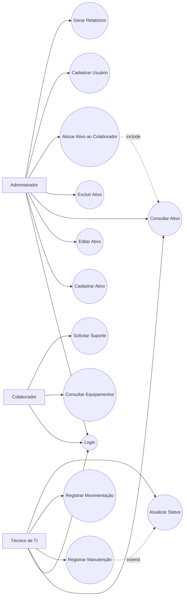

# 🖥️ Sistema de Inventário de TI

## 📋 Sobre o Projeto

Sistema desenvolvido para gerenciamento e controle de ativos de Tecnologia da Informação, permitindo o cadastro, consulta, movimentação e acompanhamento de equipamentos, softwares e demais recursos tecnológicos da organização.

## 🎯 Objetivo

O projeto tem como objetivo aplicar conceitos de análise de sistemas, levantamento de requisitos, modelagem UML e gestão de ativos de TI para apoiar a governança e o controle patrimonial dos recursos tecnológicos.

## 👥 Atores

- Administrador
- Técnico de TI
- Colaborador

## ✅ Funcionalidades

- Cadastro de ativos
- Consulta de ativos
- Controle de movimentações
- Registro de manutenções
- Gestão de usuários
- Emissão de relatórios
- Controle de status dos equipamentos

## 🏛️ Diagrama de Casos de Uso

## 🗄️ Regras de Negócio

1. Todo ativo deve possuir um número de patrimônio único.
2. Um ativo só poderá ser atribuído a um colaborador por vez.
3. Toda movimentação deve ficar registrada no histórico.
4. Equipamentos em manutenção não podem ser alocados.
5. Apenas administradores podem excluir ativos.

## 🛠️ Tecnologias e Conceitos

- Engenharia de Software
- UML
- Casos de Uso
- Análise de Requisitos
- Modelagem de Sistemas
- Banco de Dados
- Governança de TI

## 🚀 Melhorias Futuras

- Dashboard de indicadores
- Controle de garantias
- Inventário por QR Code
- Exportação de relatórios PDF
- Integração com sistema de chamados
- Alertas de manutenção preventiva

## 👩‍💻 Desenvolvido por

Maristela Costa
