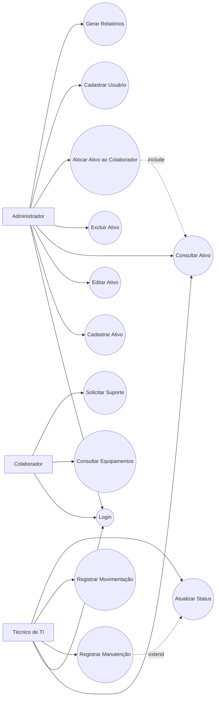
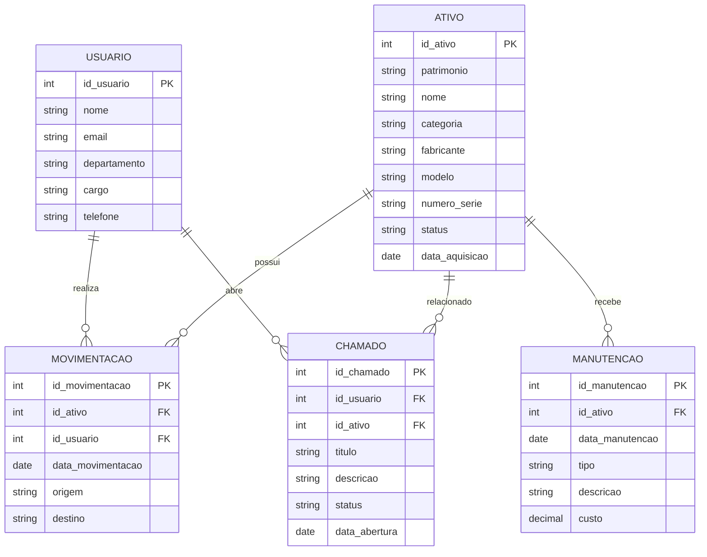

# 🖥️ Sistema de Gestão de Ativos de TI (IT Asset Management)

## 📋 Sobre o Projeto

O Sistema de Gestão de Ativos de TI foi desenvolvido para apoiar o gerenciamento, controle e rastreabilidade dos recursos tecnológicos de uma organização.

A solução permite o cadastro, acompanhamento e monitoramento de equipamentos, usuários, movimentações, manutenções e chamados técnicos, contribuindo para a governança de TI e controle patrimonial.

---

## 🎯 Objetivos

- Gerenciar ativos tecnológicos da organização.
- Controlar o ciclo de vida dos equipamentos.
- Registrar manutenções preventivas e corretivas.
- Controlar movimentações entre setores.
- Gerenciar chamados de suporte.
- Disponibilizar informações para tomada de decisão.
- Apoiar processos de Governança de TI.

---

## 🏗️ Arquitetura da Solução

O sistema foi projetado para centralizar o gerenciamento dos ativos tecnológicos em uma única plataforma.

### Módulos

- Gestão de Ativos
- Gestão de Usuários
- Gestão de Manutenções
- Gestão de Movimentações
- Gestão de Chamados
- Relatórios Gerenciais

---

## 👥 Atores do Sistema

### Administrador

Responsável pelo gerenciamento completo do sistema.

### Técnico de TI

Responsável pela manutenção e atualização dos ativos.

### Colaborador

Usuário associado aos equipamentos ativos.

---

## ✅ Funcionalidades

- Login de usuários
- Cadastro de ativos
- Atualização de ativos
- Exclusão de ativos
- Consulta de ativos
- Cadastro de usuários
- Alocação de equipamentos
- Controle de movimentações
- Registro de manutenções
- Histórico de alterações
- Gestão de chamados
- Emissão de relatórios

---

## 🏛️ Diagrama de Casos de Uso



---

## 🗄️ Modelo Entidade-Relacionamento (ERD)



---

## 🏗️ Diagrama de Classes UML

```mermaid
classDiagram

class Usuario {
    +int idUsuario
    +String nome
    +String email
    +String departamento
    +String cargo
    +String telefone

    +consultarAtivos()
    +abrirChamado()
}

class Ativo {
    +int idAtivo
    +String patrimonio
    +String nome
    +String categoria
    +String fabricante
    +String modelo
    +String numeroSerie
    +String status
    +Date dataAquisicao

    +cadastrar()
    +editar()
    +consultar()
    +atualizarStatus()
}

class Manutencao {
    +int idManutencao
    +Date dataManutencao
    +String tipo
    +String descricao
    +Double custo

    +registrar(
