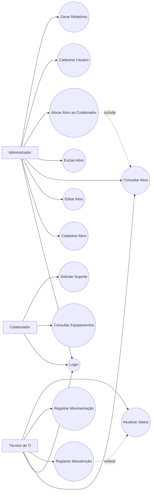
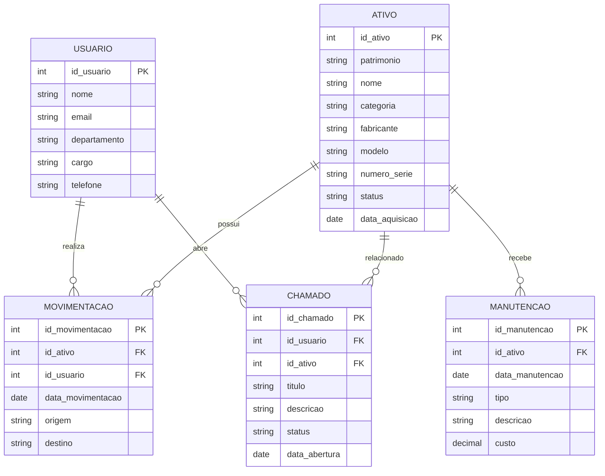

# 🖥️ Sistema de Inventário de TI

## 📋 Sobre o Projeto

O Sistema de Inventário de TI foi desenvolvido com o objetivo de apoiar o gerenciamento e controle dos ativos tecnológicos de uma organização. O projeto contempla o cadastro, consulta, manutenção e movimentação de equipamentos de TI, proporcionando maior organização, rastreabilidade e suporte à governança tecnológica.

---

## 🎯 Objetivos

- Controlar ativos de TI da organização.
- Registrar movimentações de equipamentos.
- Gerenciar manutenções preventivas e corretivas.
- Controlar responsáveis pelos ativos.
- Disponibilizar informações para tomada de decisão.
- Apoiar processos de Governança de TI.

---

## 👥 Atores do Sistema

### Administrador
Responsável pela gestão completa do inventário.

### Técnico de TI
Responsável pela manutenção e atualização dos ativos.

### Colaborador
Usuário final associado aos equipamentos.

---

## ✅ Funcionalidades

- Login de usuários
- Cadastro de ativos
- Atualização de ativos
- Exclusão de ativos
- Consulta de ativos
- Cadastro de usuários
- Controle de movimentações
- Registro de manutenções
- Acompanhamento de histórico
- Abertura de chamados
- Emissão de relatórios gerenciais

---

## 🏛️ Diagrama de Casos de Uso

---

## 🗄️ Modelo Entidade-Relacionamento (ERD)

---

## 📜 Regras de Negócio

1. Cada ativo deve possuir um número de patrimônio único.
2. Um ativo não pode ser vinculado simultaneamente a mais de um colaborador.
3. Toda movimentação deve ser registrada no histórico.
4. Equipamentos em manutenção não podem ser alocados.
5. Apenas administradores podem excluir ativos.
6. Toda manutenção deve possuir data e descrição.
7. Chamados devem estar vinculados a um usuário e a um ativo.

---

## 📊 Indicadores Gerenciais

O sistema pode fornecer indicadores como:

- Quantidade total de ativos
- Ativos por categoria
- Ativos em manutenção
- Ativos disponíveis
- Ativos por departamento
- Histórico de movimentações
- Chamados em aberto
- Custos com manutenção

---

## 🛠️ Tecnologias e Conceitos Aplicados

- Engenharia de Software
- UML
- Casos de Uso
- Modelagem de Banco de Dados
- Regras de Negócio
- Governança de TI
- Gestão de Ativos de TI (IT Asset Management)
- Banco de Dados Relacional
- Levantamento de Requisitos

---

## 🚀 Melhorias Futuras

- Dashboard em Power BI
- Integração com API REST
- Controle de licenças de software
- Geração de relatórios PDF
- Inventário por QR Code
- Controle de garantias
- Sistema de notificações
- Integração com Service Desk

---

## 👩‍💻 Desenvolvido por

**Maristela Costa**

Bacharel em Sistemas de Informação

MBA em Cibersegurança e Proteção de Dados (em andamento)

MBA em Business Intelligence, Big Data e Analytics (em andamento)

GitHub: github.com/maristelacosta
